# E-commerce Sales & Customer Analytics

**Exploratory data analysis of about 138,000 orders and 397,000 order items: what drives profit, returns and cancellations, and how to prepare the data for a machine learning model.**

`Python` · `pandas` · `NumPy` · `Matplotlib` · `Seaborn` · `Google Colab`

Notebook: [`notebooks/ecommerce_sales_eda.ipynb`](notebooks/ecommerce_sales_eda.ipynb)

---

## Project overview

An online store sells across 7 countries, 4 sales channels and 15 product categories. The data is spread over four tables (orders, order items, products and customers). The goal of this project was to answer three questions:

1. Can the data be trusted, and do the four tables agree with each other?
2. What really drives **profit**, **returns** and **cancellations**?
3. Which columns are safe to use in a prediction model, and which ones give the answer away?

The most important result is that the profit figures in the data are **not reliable as they are**. They include collected tax, which hides losses and makes some countries look more profitable than they are.

## Key insights

### 1. Tax was hiding the real profit
`net_sales` and `profit` include the tax collected from customers. Profit looked **35% higher in the UK than in the UAE**, although discount, product cost and customer mix were almost identical. The tax as a share of (gross − discount) was UAE 5%, USA 7%, Australia 10%, Canada 13%, India 18%, Germany 19% and UK 20%, which matches real VAT/GST rates.

After removing tax, profit per order is between **398 and 413 in every country**. Removing tax also **doubles the share of loss-making orders, from 1.08% to 2.11%**. Every profit figure after this point uses profit without tax.

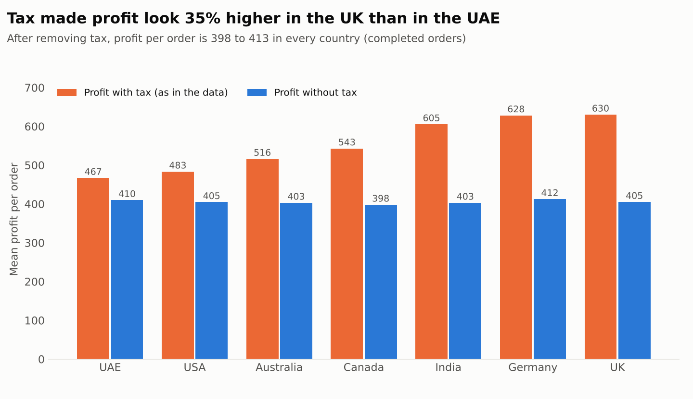

### 2. Discount is the biggest driver of profit
Profit per order stays flat up to 10% discount and then falls. Orders start to lose money at about **30-35% discount**. Above 40% discount, **31% of orders lose money**, and about 90% of all loss-making orders sit in that group.

| Discount | Orders | Profit per order | Margin | Loss-making orders |
|---|---|---|---|---|
| up to 5% | 9,652 | 487 | 45.1% | 0.0% |
| 5-10% | 23,452 | 509 | 43.4% | 0.0% |
| 10-15% | 26,999 | 460 | 40.5% | 0.0% |
| 15-20% | 19,410 | 384 | 36.9% | 0.0% |
| 20-25% | 10,001 | 369 | 32.8% | 0.0% |
| above 25% | 24,045 | 242 | 19.1% | 10.0% |

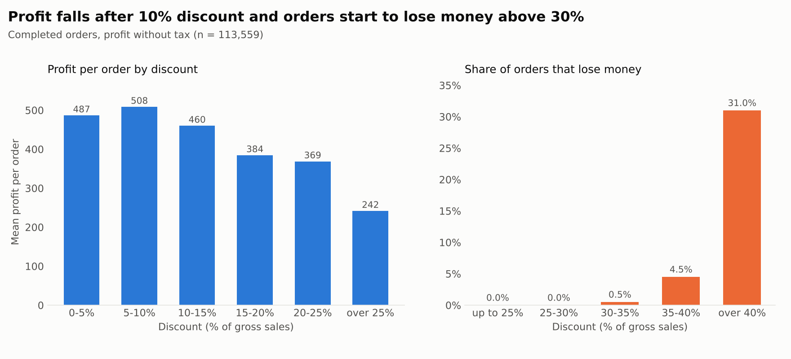

### 3. Premium and VIP customers earn less because they get deeper discounts
At first, Premium and VIP orders looked less profitable than Consumer and Business orders. But up to 20% discount, all four segments earn about the same per order. The gap only appears above 25% discount, where Premium and VIP get deeper discounts (38.6% against 34.2% on average) and have more of their orders (26.5% against about 18%).

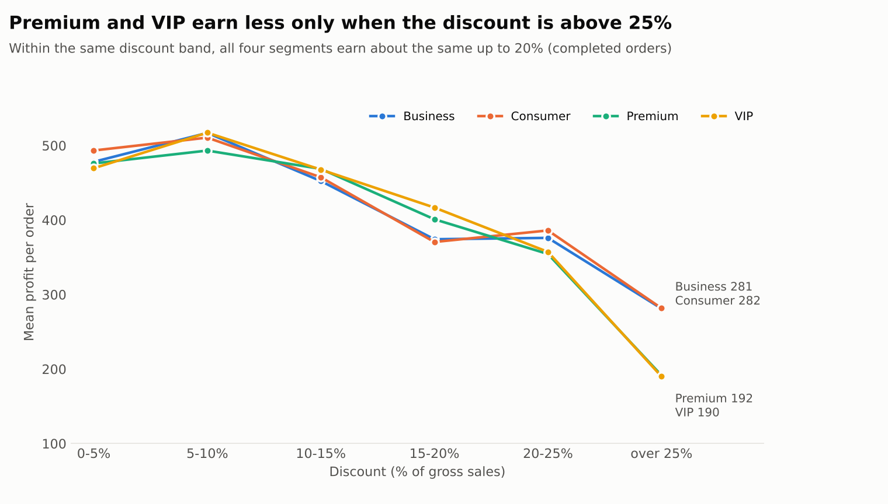

### 4. Expensive products have the lowest margins
At item level, margin falls as price rises: about 25% for Electronics, 31% for Automotive and 33% for Jewelry and Home Appliances, against about 50% for Grocery. Electronics earns the most per item (354) but at the lowest margin, and 7.3% of its items lose money. Across five equal price bands, the margin falls from 42.7% to 30.6%. Brand follows category: the lowest-margin brands (Sony, Xiaomi, Asus, Samsung, LG) are all electronics brands.

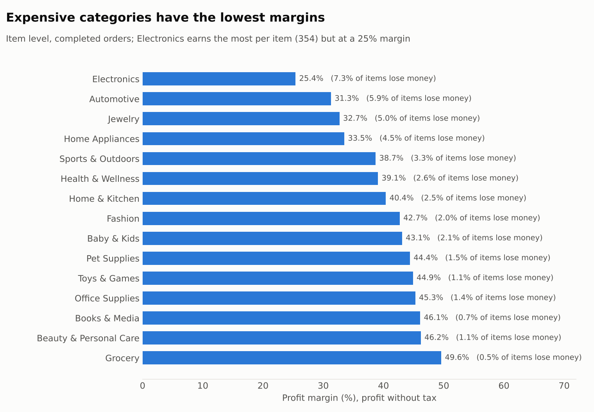
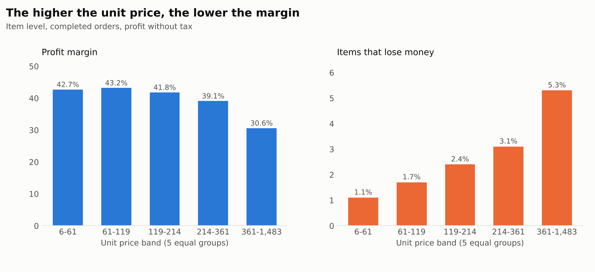

Every category has a similar number of items, but Electronics, Jewelry and Home Appliances bring 48% of revenue because of their prices.

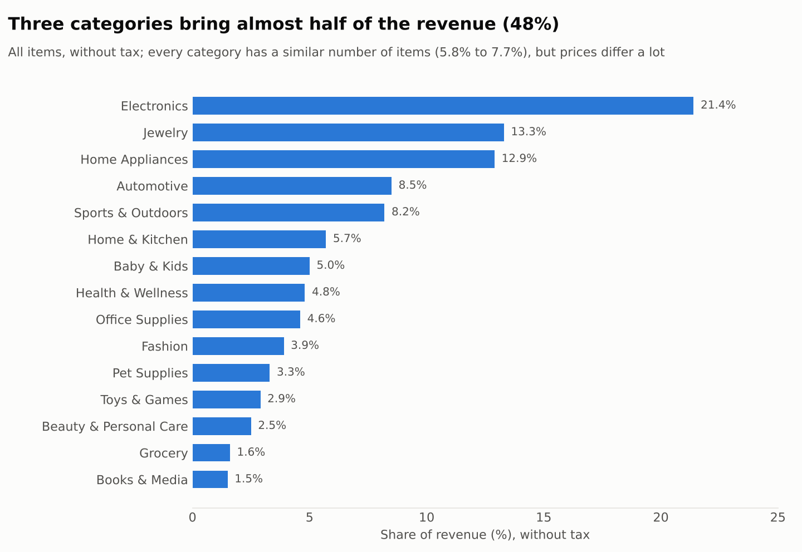

### 5. Late deliveries get lower ratings
Of the Completed orders, 76.5% arrive on time, 14.9% are delayed and 8.6% early. Average rating is **3.22 for delayed, 3.73 for on-time and 4.02 for early orders**. The rating changes in steps by delivery status, not with the number of days late. This is a link, not proof that delay causes the lower rating.

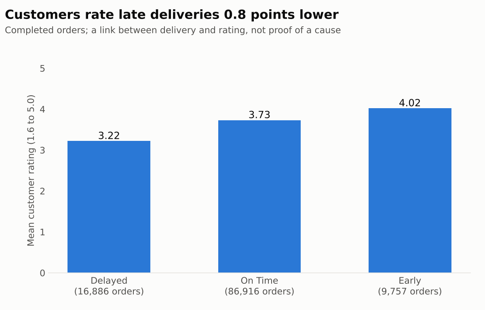

### 6. Channel, age, gender and country make almost no difference
Profit per order and margin are almost the same across sales channels, age groups, genders and countries (after removing tax).

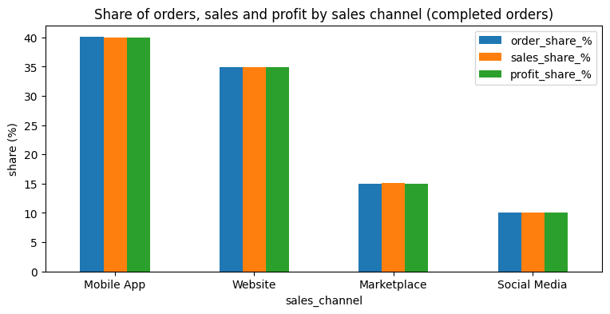
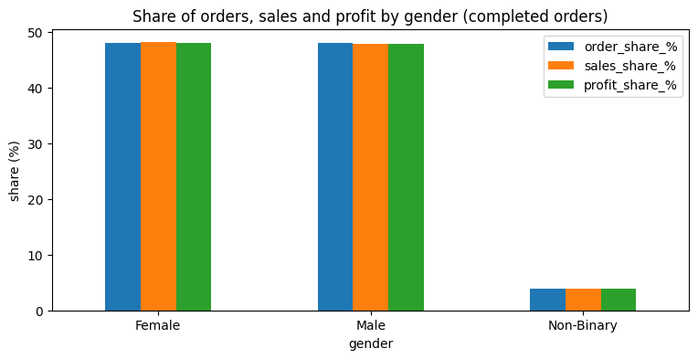
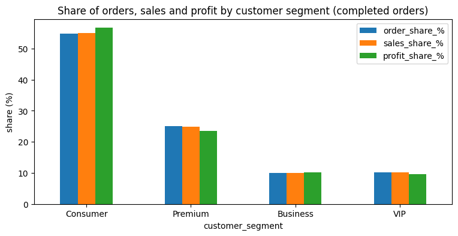
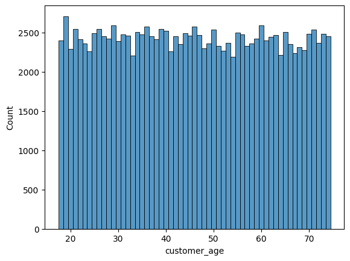

These very regular patterns (a 48/48/4 gender split, almost uniform age from 18 to 74) suggest the data may be synthetic.

### 7. Other observations
- **Net sales is right-skewed** (mean 1,270, median 943). About 4.6% of orders are outliers and carry 17.2% of revenue. They look like genuine large orders, so I kept them.
- **Returns:** the return rate is 7.69% overall and the cancellation rate is 6.08%. Return rates are similar in all product categories (7.3% to 8.1%). The Non-Binary group has a higher return rate (8.82%), but it is a small group and I have not tested the gap.
- **Higher-rated products** have a slightly lower return rate, but the difference is small and noisy.

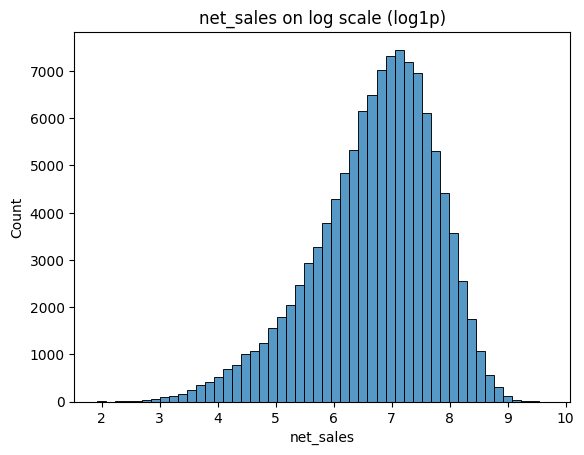
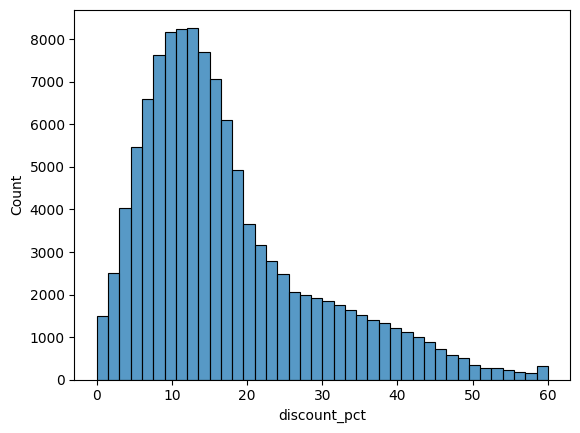
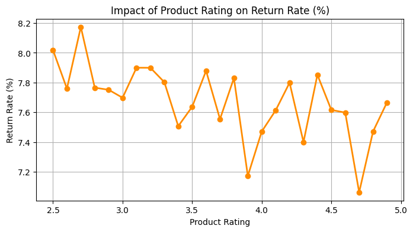
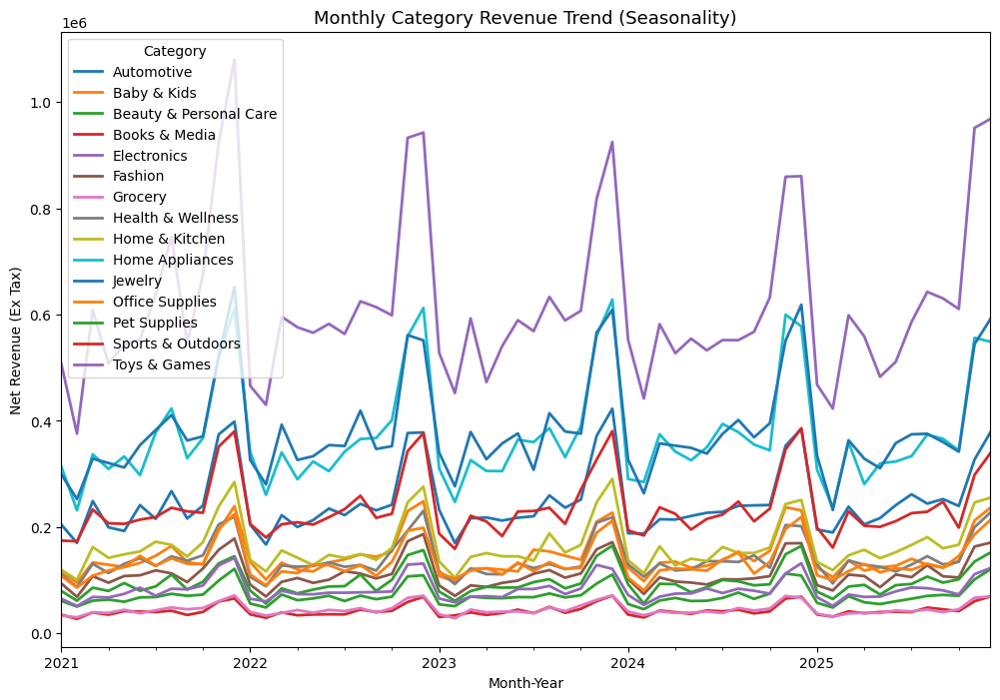

## Data and data quality

Four tables (not included in this repo, see [`data/README.md`](data/README.md)):

| Table | Rows are |
|---|---|
| `ecommerce_sales_customer_analytics_150k` | orders |
| `order_items` | items in an order |
| `product_catalog` | products |
| `customer_master` | customers |

From these I built `order_df` (138,116 orders) and `item_df` (397,569 items). Profit tables use **Completed** orders (113,559).

What I found while checking the data:
- The tables agree on age, gender, segment and region (0% mismatch).
- For 11,226 orders (about 8%), the order-level totals differ from the item-level totals. Item-level is always higher, so I do not compare item numbers directly with order numbers.
- `currency` and `customer_country` hold the same information (one currency per country). All amounts are in one common unit.
- `delivery_status` is tied to `order_status`: only Completed orders have a delivery timing. Every Cancelled, Pending and Returned order has "Cancelled" in this column, even the 9,462 Returned ones.
- At item level, prices and costs equal the catalog values, and `discount_percentage` is a fraction (0.147 = 14.7%).
- There are no missing values or duplicate rows in the item table.

## Method
1. Checked keys, join coverage and whether the tables agree.
2. Looked at each important column on its own, then profit, return and cancellation tables by group.
3. Found that profit includes tax and created `profit_ex_tax` and `net_sales_ex_tax`.
4. Tested three hypotheses about discount, profit and customer segment using discount bands.
5. Repeated the analysis at item level (category, brand, price, returns, basket size, seasonality).
6. Wrote a reusable `EDA` class and a `share_table` helper.

## Recommendations (based on this data)
- **Cap discounts at about 30%.** Above 35% discount, orders are close to zero profit or lose money; above 40%, one order in three loses money.
- **Review the discount policy for Premium and VIP customers.** Their lower profit comes from deeper discounts, not from the customers themselves.
- **Check discounts on Electronics, Automotive and Jewelry.** They already have the lowest margins.
- **Keep delivery on time.** Delayed orders get ratings that are 0.5 to 0.8 points lower.
- **Report profit without tax.** Profit with tax overstates profit and hides loss-making orders.

## Preparing for machine learning
- **Target:** `profit_ex_tax`.
- **Do not use as features:** `net_sales`, `tax_amount`, `product_cost` and `shipping_cost` (they build profit directly); `returned`, `return_reason` and `delivery_status` (they show the outcome).
- **Keep only one** of `currency` and `customer_country`.
- **Good features to try:** `discount_pct`, `unit_price` (log), `product_category`, `customer_segment`, `quantity`, `product_rating`.

## Limitations
- Descriptive analysis only: averages, with no significance tests yet.
- The data looks synthetic, so the results may not hold for a real shop.
- Returned orders have no delivery timing or rating, so I cannot test if delivery affects returns.
- Discount is linked to lower profit, but I did not separate it from product mix.
- At item level, `returned` is the return flag of the whole order.
- Price, brand and category move together, so their separate effects are not clear.
- The charts above were drawn from numbers in the notebook outputs.

## Next steps
- [x] Data checks, tax, discount and item-level analysis
- [ ] Re-run the channel, age, gender and segment tables with profit without tax
- [ ] Finish item-level discount by category and rating vs return
- [ ] Inferential statistics (tests for the main findings)
- [ ] Feature engineering, encoding and scaling
- [ ] Regression model, evaluation and a small app

## How to run
The notebook was written in Google Colab.
1. Put the four data files in a Drive folder (default path `/content/drive/MyDrive/Data`).
2. Open the notebook in Colab and run all cells.

To run locally: `pip install -r requirements.txt`, then change the `load_all(...)` path in the notebook.

## Repository structure
```
ecommerce-sales-analysis/
├── README.md
├── requirements.txt
├── .gitignore
├── images/                 # charts used in this README
├── data/README.md          # data description (files not committed)
└── notebooks/
    └── ecommerce_sales_eda.ipynb
```
